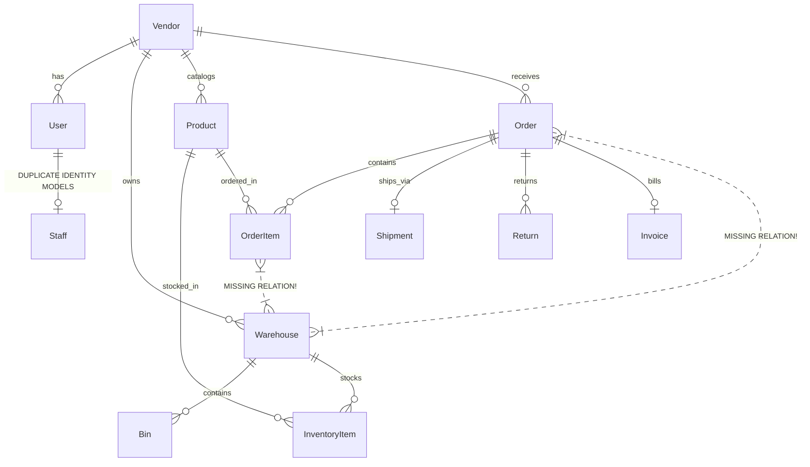

# FCOS Database & Data Integrity Audit

**Audit Date:** November 9, 2026  
**Auditor Roles:** Senior Database Architect, Backend Engineer, QA Lead

---

## 1. Schema Architecture & Entity Relationship Review

The database utilizes PostgreSQL 15 managed via Prisma ORM (`backend/prisma/schema.prisma`). The schema specifies **26 models**, 4 native PostgreSQL enums (`UserRole`, `OrderStatus`, `StockMovementType`, `TaskStatus`), and 28 relational indices.

### Critical Entity Relationship Gaps



---

## 2. Structural Schema & Relational Defects

### 2.1 The Missing Warehouse Foreign Key on Orders (Fatal Architectural Gap)
- **Defect:** In `schema.prisma` lines 192–224, the `Order` model contains `vendorId`, `customerName`, `addressLine1`, etc., but **does not contain `warehouseId`**. Furthermore, `OrderItem` contains only `orderId`, `productId`, `quantity`, and `price`.
- **Consequence:** An order has no record of which physical warehouse is fulfilling it. When inventory is deducted in `OrdersService.create`, it executes:
  ```typescript
  const inventoryItems = await tx.inventoryItem.findMany({
    where: { productId: item.productId },
    orderBy: { quantity: 'desc' },
  });
  ```
  It queries across **all warehouses globally** and deducts from whichever warehouse happens to hold stock first, even if that warehouse belongs to another facility across the country.

### 2.2 Nullable Unique Constraint Flaw on InventoryItem
- **Defect:** `InventoryItem` declares:
  ```prisma
  binId String?
  bin   Bin?    @relation(fields: [binId], references: [id])
  ...
  @@unique([productId, warehouseId, binId])
  ```
- **Consequence:** In standard PostgreSQL behavior, `NULL` values are considered distinct in unique constraints. As a result, PostgreSQL allows multiple rows with the exact same `productId` and `warehouseId` as long as `binId` is `NULL`.
- **Impact:** Calling `tx.inventoryItem.upsert({ where: { productId_warehouseId_binId: { productId, warehouseId, binId: null } } })` throws runtime database errors because Prisma's unique compound index cannot uniquely identify rows when a component is null.

### 2.3 Dual Identity Models (`User` vs `Staff`) & Foreign Key Collision Risk
- **Defect:** The system maintains two separate models for staff personnel:
  1. `User`: Handles authentication, role, email, and password.
  2. `Staff`: Contains employee metadata, warehouse assignment, designation, and performance score.
- **Relational Inconsistency:** `StaffTask` has `staffId String` which references `User.id`:
  ```prisma
  model StaffTask {
    staffId String
    staff   User   @relation(fields: [staffId], references: [id])
  }
  ```
- **Crash Bug in ReturnsService:** In `backend/src/modules/returns/returns.service.ts` line 68:
  ```typescript
  await this.prisma.staffTask.create({
    data: {
      orderId,
      staffId: staff.userId || staff.id, // CRASH HAZARD!
      taskType: 'RETURN_VERIFY',
      status: 'PENDING',
    },
  });
  ```
  If a staff record has `userId = null` (which `Staff` schema explicitly allows: `userId String? @unique`), it falls back to `staff.id`. Passing `staff.id` into `staffId` crashes with a **Prisma Foreign Key Constraint Violation** (`Foreign key constraint violated on fields: ("staffId")`) because `staff.id` does not exist in the `User` table!

---

## 3. Data Integrity & Business Logic Flaws

### 3.1 The Double Stock Deduction Bug
- **Code Locations:** `OrdersService.create` (lines 71–98) and `InventoryService.scanOut` (lines 315–323)
- **Trace:**
  1. Customer orders 10 units of SKU A.
  2. `OrdersService.create` executes inside a transaction and decrements `InventoryItem.quantity` by 10.
  3. Picker opens `execution/picking/page.tsx` to physically pick the order and scans the item.
  4. The frontend calls `POST /inventory/scan-out`.
  5. `InventoryService.scanOut` calls `updateStock(..., -10, StockMovementType.OUTBOUND, ...)`, decrementing inventory by **another 10 units**.
- **Audit Impact:** For every order fulfilled through the staff picking terminal, **double the ordered quantity is subtracted from the database**. 10 ordered units results in 20 units deducted.

### 3.2 The Phantom Stock Creation Bug (Order Cancellation)
- **Code Location:** `backend/src/modules/orders/orders.service.ts` lines 356–375
- **Trace:**
  1. Assume product stock is 2 units.
  2. An order is submitted for 10 units. `OrdersService.create` deducts the 2 units and leaves a shortage of 8 units without failing.
  3. Stock balance is now 0 units.
  4. The order is cancelled via `POST /orders/:id/cancel`.
  5. `cancelOrder` loops over `order.items` and adds `item.quantity` (10 units) into the first available bin:
     ```typescript
     await tx.inventoryItem.update({
       where: { id: inventoryItem.id },
       data: { quantity: { increment: item.quantity } }, // increments by 10!
     });
     ```
  6. **Inventory is incremented to 10 units.** The database now contains 8 phantom units that never existed in the warehouse.

### 3.3 Double Restocking on Returns
- **Code Locations:** `ReturnsService.approveReturn` (lines 120–135) and `BarcodeService.handleReturnVerify` (lines 190–204)
- **Trace:**
  1. A return request is approved in the management portal via `POST /returns/:id/approve`.
  2. `approveReturn` immediately executes `increment: item.quantity` on `InventoryItem`.
  3. Later, the physical package arrives at the loading dock. Staff scans the barcode in `BarcodeService.handleReturnVerify`.
  4. `handleReturnVerify` executes `increment: 1` on `InventoryItem` a second time.
- **Audit Impact:** Every returned item is restocked twice in the database, leading to inflated inventory counts and subsequent fulfillment failures when the phantom stock is purchased.

---

## 4. Transaction & Concurrency Audit

### 4.1 Missing Database Row Locks Under Concurrent Ordering
- **Defect:** In `OrdersService.create`, `tx.inventoryItem.findMany` executes an unbuffered `SELECT` without row locking (`FOR UPDATE` / `SELECT FOR UPDATE`).
- **Concurrency Test Analysis:**
  - If initial stock = 1 unit, and two customers simultaneously place orders for 1 unit:
    - Thread 1 reads stock = 1.
    - Thread 2 reads stock = 1.
    - Thread 1 decrements stock to 0.
    - Thread 2 decrements stock to -1 or triggers a race failure.
  - The system fails to prevent overselling under high concurrency.
- **Remediation:** Use `prisma.$queryRaw` with `SELECT ... FOR UPDATE` or atomic decrement with condition:
  ```sql
  UPDATE "InventoryItem" 
  SET "quantity" = "quantity" - :qty 
  WHERE "id" = :id AND "quantity" >= :qty
  ```

---

## 5. Currency & Decimal Precision Audit

- **Schema Definition:** Financial columns (`price`, `totalAmount`, `gstAmount`, `refundAmount`) are declared as `Decimal @db.Decimal(10, 2)`. This provides proper 2-decimal place fixed-point storage in PostgreSQL.
- **Service Layer Precision Loss:** Throughout the services (`orders.service.ts`, `inventory.service.ts`, `analytics.service.ts`), `Decimal` objects are repeatedly converted via `Number(decimal)` or `parseFloat(decimal)`.
- **Risk:** JavaScript IEEE 754 64-bit floating point arithmetic introduces rounding errors in financial aggregations (e.g. `0.1 + 0.2 = 0.30000000000000004`).
- **Remediation:** Keep values in fixed-point or utilize a decimal math library (such as `decimal.js` or `Prisma.Decimal`) throughout calculations.

