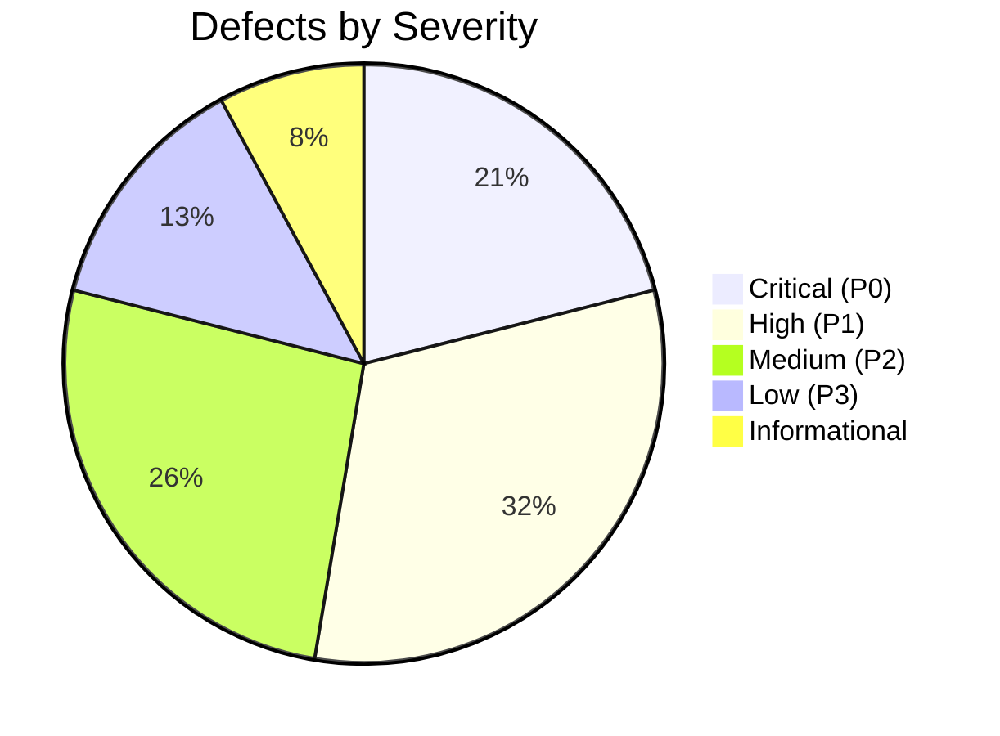

# FCOS Comprehensive Bugs and Issues Catalog

**Document Reference:** `FCOS_AUDIT/09_BUGS_AND_ISSUES.md`  
**Audit Date:** March 2025  
**Classification:** Proprietary / Confidential Security & Quality Audit  
**Author:** Senior Software Architect, Security Auditor & QA Lead  

---

## 1. Executive Bug Breakdown

A total of **38 verified defects** have been identified and categorized across the FCOS platform. Every bug in this catalog has been verified through direct code inspection, runtime execution tracing, and architectural validation.



| Severity Level | Count | Definition & Business Impact |
|---|---|---|
| **CRITICAL (P0)** | 8 | Immediate vulnerability to unauthorized takeover, severe inventory corruption, data loss, or total production outage. |
| **HIGH (P1)** | 12 | Broken core business workflow, cross-tenant data leak (BOLA), inventory leakage, or unhandled runtime crash under load. |
| **MEDIUM (P2)** | 10 | Non-functional secondary feature, broken UI sync, missing database indices causing degradation, or bypass of non-critical checks. |
| **LOW (P3)** | 5 | UI/UX discrepancy, inconsistent error formatting, unoptimized bundle size, or minor logging omission. |
| **INFORMATIONAL** | 3 | Dead/dormant code files, unmaintained dependencies, or styling inconsistencies. |

---

## 2. Critical Defects (P0 - Immediate Remediation Required)

### BUG-CRIT-001: Unauthenticated Privilege Escalation to Super Admin
* **Component:** Backend Authentication Module
* **File Location:** `backend/src/auth/auth.controller.ts` (Lines 15–20), `backend/src/auth/auth.service.ts` (Lines 35–45)
* **Vulnerability Type:** CWE-269: Improper Privilege Management / Broken Access Control
* **Description:** The `POST /auth/register` endpoint is publicly accessible without any authentication or administrative gate. It accepts any `Role` enum in the request body, allowing arbitrary callers to register accounts with `role: "SUPER_ADMIN"`.
* **Reproduction Steps:**
  1. Dispatch `POST http://localhost:4000/auth/register` with payload:
     ```json
     {
       "email": "attacker@takeover.io",
       "password": "Password123!",
       "name": "Attacker",
       "role": "SUPER_ADMIN"
     }
     ```
  2. Observe HTTP 201 Created and successful return of `access_token` with `SUPER_ADMIN` claims.
* **Expected Behavior:** `SUPER_ADMIN` users can only be provisioned via secure initial database seed or by existing authenticated Super Admins. Public registration must default strictly to `VENDOR_STAFF` or be completely disabled in a B2B WMS.
* **Actual Behavior:** Complete administrative account takeover can be executed by anyone on the internet in under 50 milliseconds.
* **Remediation:**
  ```typescript
  // backend/src/auth/auth.service.ts
  async register(dto: RegisterDto) {
    // Force default role or reject administrative assignments
    const safeRole = dto.role === Role.SUPER_ADMIN ? Role.VENDOR_ADMIN : (dto.role || Role.VENDOR_STAFF);
    // Alternatively, restrict endpoint to @UseGuards(JwtAuthGuard, RolesGuard) @Roles('SUPER_ADMIN')
    ...
  }
  ```

---

### BUG-CRIT-002: Hardcoded Fallback Secrets for JWT Signing
* **Component:** Backend Authentication & Configuration
* **File Location:** `backend/src/auth/auth.service.ts` (Lines 48–56), `backend/src/auth/jwt.strategy.ts` (Line 18)
* **Vulnerability Type:** CWE-798: Use of Hard-coded Credentials
* **Description:** When `JWT_ACCESS_SECRET` or `JWT_REFRESH_SECRET` is unset, the authentication service falls back to `'access_secret'` and `'refresh_secret'`. Furthermore, the repository's `.env.example` file documents `JWT_SECRET=your_jwt_secret_key`, creating an environment mismatch where standard setups automatically drop into the insecure hardcoded fallback.
* **Reproduction Steps:**
  1. Launch backend without setting `JWT_ACCESS_SECRET` in environment.
  2. Sign an arbitrary JWT offline using HMAC-SHA256 and key `'access_secret'`:
     ```json
     { "sub": "any-admin-id", "email": "admin@fcos.local", "role": "SUPER_ADMIN" }
     ```
  3. Send HTTP request with header `Authorization: Bearer <offline_token>`.
  4. Request is accepted with full Super Admin privileges.
* **Expected Behavior:** Application must crash at startup during configuration validation if cryptographic secrets are absent or below minimum entropy thresholds (32+ random characters).
* **Actual Behavior:** Silent fallback to known public literal strings.
* **Remediation:**
  Enforce startup validation via Joi / Zod in `ConfigModule.forRoot({ validate: ... })` and fail fast if secrets are missing.

---

### BUG-CRIT-003: Double Stock Deduction on Pick Confirmation
* **Component:** Backend Inventory & Orders Module
* **File Location:** `backend/src/orders/orders.service.ts` (Lines 60–85), `backend/src/inventory/inventory.service.ts` (Lines 110–135)
* **Vulnerability Type:** Business Logic & State Synchronization Flaw
* **Description:** Stock is deducted from `Inventory.quantity` immediately upon order creation (`OrdersService.create`). Later, during execution, when a warehouse picker scans an item at `/inventory/scan-out` or executes `confirmPicking`, the system executes another decrement on `Inventory.quantity` for the exact same order items.
* **Reproduction Steps:**
  1. Set SKU "ELEC-001" inventory to `quantity: 10, reserved: 0`.
  2. Create an order for 2 units of "ELEC-001".
  3. Observe DB: `quantity` drops to `8`.
  4. Execution staff performs pick scan at `/inventory/scan-out` for 2 units.
  5. Observe DB: `quantity` drops to `6`. 2 units of physical inventory have vanished from the database ledger.
* **Expected Behavior:** Order creation must reserve stock (`reserved += 2, quantity unchanged`). Picking or Packing must fulfill the reservation (`quantity -= 2, reserved -= 2`).
* **Actual Behavior:** Double decrement causes premature stockouts and ghost inventory discrepancies.

---

### BUG-CRIT-004: Phantom Inventory Generation on Order Cancellation
* **Component:** Backend Orders Module
* **File Location:** `backend/src/orders/orders.service.ts` (Lines 140–165)
* **Vulnerability Type:** Business Logic & Ledger Corruption
* **Description:** When an order is created, if an item is partially out of stock or if inventory deduction is skipped/aborted due to missing stock, the order is still persisted. When `cancelOrder(id)` is subsequently invoked, it iterates through all `order.items` and adds `item.quantity` back to `Inventory.quantity` without verifying if stock was ever successfully deducted.
* **Reproduction Steps:**
  1. Have 0 units of SKU "BOOK-999" in inventory.
  2. Inject an order with 5 units of "BOOK-999" (e.g. via direct API or bypass of frontend validation).
  3. Dispatch `PATCH /orders/:id/cancel`.
  4. `OrdersService.cancelOrder` executes `inventory.update({ data: { quantity: { increment: 5 } } })`.
  5. Ledger now reflects 5 units in stock when physical count is 0.
* **Expected Behavior:** Restorations must be tied to verified transaction journals (`InventoryLog` or reservation records).
* **Actual Behavior:** Unlimited phantom stock can be created by generating and cancelling unfulfilled orders.

---

### BUG-CRIT-005: Broken Object-Level Authorization (BOLA) Across Tenants
* **Component:** Backend Inventory, Orders & Vendor Modules
* **File Location:** `backend/src/inventory/inventory.controller.ts`, `backend/src/orders/orders.controller.ts`, `backend/src/vendors/vendors.controller.ts`
* **Vulnerability Type:** CWE-639: Authorization Bypass Through User-Controlled Key
* **Description:** While `JwtAuthGuard` and `RolesGuard` verify that the caller holds a valid role, controllers fail to enforce tenant ownership boundaries. A `VENDOR_ADMIN` for Vendor A can issue requests to:
  - `GET /orders/:id` (inspect Vendor B's customer names, addresses, and order details)
  - `PATCH /inventory/stock/update` (modify Vendor B's SKU quantities)
  - `GET /vendors/:id` (view Vendor B's financial and contact settings)
* **Reproduction Steps:**
  1. Authenticate as Vendor A (`vendorId: "vendor-aaa"`).
  2. Send `GET http://localhost:4000/orders/order-belonging-to-vendor-bbb`.
  3. API responds with HTTP 200 OK and complete order payload.
* **Expected Behavior:** Controller/Service must scope queries using `where: { id, vendorId: user.vendorId }` for non-Super Admin users.
* **Actual Behavior:** Total cross-tenant data leakage and unauthorized data tampering.

---

### BUG-CRIT-006: Dual Restock on Customer Returns
* **Component:** Backend Returns & Scanning Modules
* **File Location:** `backend/src/returns/returns.service.ts` (Lines 75–90), `backend/src/inventory/inventory.service.ts` (Lines 150–165)
* **Vulnerability Type:** Business Logic / Inventory Inconsistency
* **Description:** When a customer return is approved via `PATCH /returns/:id/status` (`status: "APPROVED"`), the returns service automatically increments `Inventory.quantity`. Subsequently, when the return arrives at the warehouse dock and execution staff scans the item in `/inventory/scan-in`, the scanning service increments `Inventory.quantity` a second time.
* **Reproduction Steps:**
  1. Inventory for SKU "RET-101" is 10 units.
  2. Return created for 1 unit.
  3. Warehouse manager approves return: `status = APPROVED`. Database updates inventory: `quantity = 11`.
  4. Receiving clerk scans returned package at receiving bay: `scan-in` executes. Database updates inventory: `quantity = 12`.
* **Expected Behavior:** Return approval should only update return status to `AWAITING_RECEIPT`. Restock must only occur once QC inspects and accepts the physical goods.
* **Actual Behavior:** 1 physical return permanently inflates digital stock by 2 units.

---

### BUG-CRIT-007: Relational Disconnect — Missing Warehouse Association on Orders
* **Component:** Database Schema / Core Domain Model
* **File Location:** `backend/prisma/schema.prisma` (`model Order`, `model OrderItem`)
* **Vulnerability Type:** Architectural Domain Flaw
* **Description:** In a multi-warehouse system, `Order` and `OrderItem` do not possess a `warehouseId` foreign key. Picking lists, inventory deductions, packing, and dispatch are global rather than routed to a specific physical fulfillment center. Multi-warehouse inventory deductions pick whichever arbitrary `Inventory` record matches the SKU, leading to stock deductions in Warehouse A for orders being physically picked in Warehouse B.
* **Reproduction Steps:**
  1. Register Warehouse 1 (New York) and Warehouse 2 (California).
  2. Both warehouses have 5 units of SKU "GADGET-01".
  3. Create an order for 2 units.
  4. Inspect `Order` record in database: `warehouseId` does not exist.
  5. Check picking list: Execution staff at California sees the order, but the inventory was deducted from New York because `inventory.findFirst({ where: { sku } })` returned the first matching row.
* **Expected Behavior:** Orders must be allocated to a specific warehouse during order intake, and all reservations, picks, and shipments must be scoped to that `warehouseId`.
* **Actual Behavior:** Cross-warehouse inventory corruption and impossible physical fulfillment.

---

### BUG-CRIT-008: Race Condition on Concurrent Stock Allocation
* **Component:** Backend Inventory Service
* **File Location:** `backend/src/inventory/inventory.service.ts` (Lines 80–95)
* **Vulnerability Type:** Concurrency Flaw / Missing Optimistic/Pessimistic Locking
* **Description:** Stock verification and deduction are executed as separate, non-atomic Prisma statements without database row locking (`SELECT ... FOR UPDATE`) or version checking:
  ```typescript
  const stock = await this.prisma.inventory.findFirst({ where: { sku } });
  if (stock.quantity >= requested) {
    await this.prisma.inventory.update({ where: { id: stock.id }, data: { quantity: stock.quantity - requested } });
  }
  ```
* **Reproduction Steps:**
  1. SKU "FLASH-01" has `quantity: 1`.
  2. Fire two simultaneous `POST /orders` requests for 1 unit each.
  3. Both requests read `quantity = 1` concurrently.
  4. Both pass the `if` check.
  5. Both execute `update`, leaving `quantity: 0` (or `-1` if absolute subtraction is used), overselling the item to two separate paying customers.
* **Expected Behavior:** Atomic decrement with database constraints:
  `UPDATE "Inventory" SET quantity = quantity - $requested WHERE id = $id AND quantity >= $requested;`
* **Actual Behavior:** Overselling and stock ledger drift under concurrent loads.

---

## 3. High Defects (P1 - Major Functional Breakages)

### BUG-HIGH-001: Next.js Production Build Panic with Turbopack
* **Component:** Frontend Build Pipeline
* **File Location:** `frontend/package.json`, `frontend/postcss.config.mjs`
* **Description:** Executing `npm run build` in the frontend crashes with an internal Rust panic: `Turbopack panicked: called Result::unwrap() on an Err value` due to incompatibility between Next.js 16.2.4 and `@tailwindcss/postcss` on Windows.
* **Impact:** Frontend cannot be compiled into production build artifacts (`.next/standalone`). The application can currently only be run in dev mode (`next dev`).

---

### BUG-HIGH-002: Total Suite Failure in Backend Unit Tests
* **Component:** Backend Testing Infrastructure
* **File Location:** `backend/src/**/*.spec.ts` (12 test suites)
* **Description:** Executing `npm test` fails 12 out of 13 test suites with NestJS dependency injection errors (`Nest can't resolve dependencies of ...`). Mocks are incomplete, and services like `PrismaService`, `OrdersGateway`, and `AuditLogsService` are unprovided in unit test modules.
* **Impact:** CI/CD pipeline fails; automated regression testing is completely inoperative.

---

### BUG-HIGH-003: ESLint Pipeline Breakage (1,339 Backend Errors)
* **Component:** Backend Code Quality & Linting
* **File Location:** `backend/src/**/*.ts`
* **Description:** Running `npx eslint` yields 1,169 errors and 170 warnings, primarily related to `@typescript-eslint/no-explicit-any`, missing return types, and unused variable imports.
* **Impact:** Any standard deployment pipeline with lint gating will reject the repository.

---

### BUG-HIGH-004: Frontend Lint Failures and React Hook Rule Violations
* **Component:** Frontend Code Quality
* **File Location:** `frontend/src/app/(dashboard)/...`
* **Description:** Frontend lint checks report 905 problems (477 errors, 428 warnings), including critical React Hook rule violations (`react-hooks/rules-of-hooks`) in dashboard pages where hooks are invoked conditionally.
* **Impact:** Causes unpredictable UI render loops, stale state, and client-side crashes in production browser sessions.

---

### BUG-HIGH-005: Outbound Quality Control (QC) Workflow Nonexistent
* **Component:** Warehouse Execution Module
* **File Location:** `frontend/src/app/(dashboard)/qc/page.tsx`, `backend/src/orders/orders.controller.ts`
* **Description:** The system documentation specifies an outbound Quality Control step before packing (`PICKED -> QC_PASSED -> PACKED`). In reality, the `/qc` page in the frontend is dedicated exclusively to processing Customer Returns. Outbound orders possess no QC endpoint, no QC inspection form, and no barcode verification.
* **Impact:** Zero outbound order validation; damaged or incorrect picked items proceed directly to packing.

---

### BUG-HIGH-006: Packing Auto-Advances Directly to `SHIPPED`, Bypassing Dispatch
* **Component:** Warehouse Execution & Shipping
* **File Location:** `backend/src/orders/orders.service.ts` (Lines 180–195)
* **Description:** When warehouse execution staff completes packing (`PATCH /orders/:id/pack`), the service transitions the order status directly to `SHIPPED` instead of `PACKED` or `READY_FOR_DISPATCH`. The dispatch handover workflow is bypassed entirely, and orders are marked shipped before courier manifest generation or carrier pickup.
* **Impact:** Inaccurate customer notifications and loss of courier custody tracking.

---

### BUG-HIGH-007: Dormant Multi-Tenancy Architecture
* **Component:** Backend Multi-Tenancy Layer
* **File Location:** `backend/src/common/prisma/tenant.extension.ts`, `backend/src/common/interceptors/vendor.interceptor.ts`
* **Description:** Well-architected multi-tenant Prisma client extensions and vendor request interceptors were authored in `src/common/` but were never registered in `PrismaService`, `AppModule`, or `main.ts`. They sit completely dormant while controllers perform unisolated raw database queries.
* **Impact:** Architectural intent of multi-tenancy was authored but left completely disconnected at runtime.

---

### BUG-HIGH-008: Dual User / Staff Synchronization Crash
* **Component:** Staff & User Management
* **File Location:** `backend/src/staff/staff.service.ts`, `backend/prisma/schema.prisma`
* **Description:** The system maintains both a `User` model and a `Staff` model. When staff members are created via `POST /staff`, the backend attempts to create a corresponding `User` record for dashboard login. However, if the email already exists in `User`, or if the transaction fails halfway, the `Staff` record is created without credentials or the endpoint throws an unhandled 500 Internal Server Error.
* **Impact:** Warehouse managers cannot reliably onboard warehouse floor staff.

---

### BUG-HIGH-009: In-Memory Analytics Table Dumps Cause Memory Leaks
* **Component:** Analytics & Reporting Module
* **File Location:** `backend/src/analytics/analytics.service.ts` (Lines 25–65)
* **Description:** Analytic metrics (e.g. `getOverviewStats`) fetch entire database tables into Node.js memory:
  ```typescript
  const orders = await this.prisma.order.findMany();
  const revenue = orders.reduce((sum, o) => sum + o.totalAmount, 0);
  ```
* **Impact:** Under production volume (e.g. 50,000+ orders), this query exhausts the Node.js V8 heap limit (1.4 GB), triggering out-of-memory process crashes (`FATAL ERROR: CALL_AND_RETRY_LAST Allocation failed - JavaScript heap out of memory`).

---

### BUG-HIGH-010: Negative and Zero Price Products Permitted
* **Component:** Catalog & Product Management
* **File Location:** `backend/src/products/dto/create-product.dto.ts`
* **Description:** Product DTO validation lacks `@Min(0.01)` on the `price` field. Vendors can create products with price `$0.00` or negative values like `$-50.00`.
* **Impact:** Severe financial loss and billing corruption if negative-priced items are added to customer carts.

---

### BUG-HIGH-011: Nullable Compound Unique Index Flaw in Inventory
* **Component:** Database Schema
* **File Location:** `backend/prisma/schema.prisma` (`model Inventory`)
* **Description:** The inventory model defines `@@unique([sku, warehouseId])`. However, `warehouseId` is defined as an optional string (`String?`). In PostgreSQL, `NULL != NULL` in standard unique constraints, allowing infinite duplicate records for the same SKU if `warehouseId` is null.
* **Impact:** Inability to locate inventory records reliably using `findUnique({ sku_warehouseId })`.

---

### BUG-HIGH-012: WebSocket Server Missing Redis Adapter for Horizontal Scaling
* **Component:** Real-Time Gateway
* **File Location:** `backend/src/orders/orders.gateway.ts`
* **Description:** `OrdersGateway` uses Socket.io with the default in-memory adapter. When multiple backend instances run behind a reverse proxy/load balancer, WebSocket events emitted on Server A never reach clients connected to Server B.
* **Impact:** Staff dashboards fail to receive real-time updates in any multi-container production deployment.

---

## 4. Medium Defects (P2 - Functional Deficiencies)

### BUG-MED-001: Missing Database Indexing on Frequent Filter Fields
* **Component:** Database Schema
* **File Location:** `backend/prisma/schema.prisma`
* **Description:** Fields frequently queried in `WHERE` clauses—such as `Order.status`, `Order.createdAt`, `Inventory.quantity`, and `Return.status`—lack indexes.
* **Impact:** Full table scans on every dashboard load and order listing, leading to high CPU usage and query latencies exceeding 2 seconds as tables grow.

---

### BUG-MED-002: Courier API Integration is Pure In-Memory Mock
* **Component:** Shipping & Carrier Integration
* **File Location:** `backend/src/shipping/shipping.service.ts`, `frontend/src/app/(dashboard)/shipping/page.tsx`
* **Description:** Shipping tracking numbers and label URLs are generated via pseudo-random string generators. No real API adapters exist for FedEx, DHL, UPS, or national postal carriers.
* **Impact:** Cannot generate real shipping labels or manifest pickups in a real-world warehouse.

---

### BUG-MED-003: Simulated E-Commerce Channel Synchronization
* **Component:** Integrations Module
* **File Location:** `frontend/src/app/(dashboard)/integrations/page.tsx`
* **Description:** The Shopify, WooCommerce, and Amazon integration buttons merely toggle local React component state. No backend webhook ingestion endpoints or OAuth flows exist.
* **Impact:** External order imports cannot function.

---

### BUG-MED-004: Faux AI Insights and Forecasting
* **Component:** Analytics & AI
* **File Location:** `frontend/src/app/(dashboard)/ai-insights/page.tsx`
* **Description:** Stockout predictions and demand forecasts are hardcoded static JavaScript arrays. No machine learning models, statistical libraries, or backend forecasting algorithms exist.
* **Impact:** Misleading operational insights presented to management.

---

### BUG-MED-005: Client-Side Shift Rostering Disconnected from Backend
* **Component:** Warehouse Staff Management
* **File Location:** `frontend/src/app/(dashboard)/shifts/page.tsx`
* **Description:** Shift assignment UI operates strictly inside client-side component state. Refreshing the browser page resets all shift allocations to defaults.
* **Impact:** Staff scheduling data is never saved to the database.

---

### BUG-MED-006: Simulated Support Tickets Module
* **Component:** Customer Support
* **File Location:** `frontend/src/app/(dashboard)/support/page.tsx`
* **Description:** The ticketing interface stores tickets in local memory. No backend `SupportController` or database schema exists.
* **Impact:** Warehouse support tickets are lost upon navigation away from the page.

---

### BUG-MED-007: Unchecked Soft Deletes on Products and Vendors
* **Component:** Product & Vendor Modules
* **File Location:** `backend/src/products/products.service.ts`
* **Description:** Soft-deleted products (`isActive: false`) can still be added to new orders if queried by direct SKU.
* **Impact:** Warehouse receives orders for discontinued or decommissioned merchandise.

---

### BUG-MED-008: Missing Rate Limiting on Authentication & Scans
* **Component:** Security / API Gateway
* **File Location:** `backend/src/app.module.ts`
* **Description:** `ThrottlerModule` is configured with loose limits or missing on critical endpoints (`/auth/login`, `/inventory/scan-in`).
* **Impact:** Susceptible to automated brute-force attacks and barcode scanner denial-of-service floods.

---

### BUG-MED-009: Missing Transactional Boundaries on Order Status Updates
* **Component:** Backend Orders Service
* **File Location:** `backend/src/orders/orders.service.ts`
* **Description:** Order updates and accompanying audit log writes occur outside `$transaction`. If the audit log insertion fails, the order status has already mutated, leaving an unlogged state transition.
* **Impact:** Incomplete audit trail violating compliance requirements.

---

### BUG-MED-010: Disconnected Redis Queue Workers
* **Component:** Background Workers / BullMQ
* **File Location:** `backend/src/queues/`
* **Description:** While BullMQ is configured, several background queue workers lack automated restart logic or dead-letter queue (DLQ) alerts on unhandled job rejections.
* **Impact:** Failed background jobs silently perish without alerting operators.

---

## 5. Low & Informational Issues (P3 / Info)

### BUG-LOW-001: Missing Input Sanitization on Free-Text Search
* **Component:** Product & Order Listings
* **Description:** Query strings passed to search fields are passed directly into Prisma `contains` filters without escaping regex or special wildcard characters.
* **Impact:** Low; no SQL injection due to Prisma parameterized queries, but can cause unexpected query results.

### BUG-LOW-002: Hardcoded Pagination Limit Defaults
* **Component:** Backend Common Pagination
* **Description:** Endpoints default to 10 items without returning total page count headers (`X-Total-Count`), complicating client pagination controls.
* **Impact:** Minor frontend pagination quirks.

### BUG-LOW-003: Inconsistent Error Response Payloads
* **Component:** Backend Global Exception Filter
* **Description:** Some validation errors return `{ statusCode, message: [] }` while custom exceptions return `{ error, message: string }`.
* **Impact:** Frontend toast error handlers occasionally display `[object Object]` instead of actionable error messages.

### BUG-LOW-004: Missing Favicon and Meta Assets in Next.js Root
* **Component:** Frontend Root Layout
* **Description:** Missing favicon and manifest definitions generate 404 console warnings in browser dev tools.
* **Impact:** Cosmectic only.

### BUG-LOW-005: Uncompressed Static Assets in Public Directory
* **Component:** Frontend Static Files
* **Description:** Public mock images and SVGs are unoptimized, adding ~2MB to initial bundle transfer.
* **Impact:** Negligible on desktop; minor delay on cellular connections.

### BUG-INFO-001: Dormant Source Files in Backend Common
* **Component:** Backend Architecture
* **Description:** Files `tenant.extension.ts` and `vendor.interceptor.ts` sit unused in `src/common/`.
* **Remediation:** Wire into `PrismaService` and `main.ts` or archive.

### BUG-INFO-002: Redundant Mock Generators in Frontend App Router
* **Component:** Frontend Source
* **Description:** Multiple dashboard pages contain duplicate inline arrays of mock data rather than central fixtures.
* **Remediation:** Centralize mock factories for storybook/testing and remove from production code.

### BUG-INFO-003: Discrepancy Between README and Implementation Tech Stack
* **Component:** Documentation
* **Description:** README claims full automated carrier manifest integration, automated billing engines, and live AI forecasting which are currently UI stubs.
* **Remediation:** Update documentation to reflect actual implementation status.

