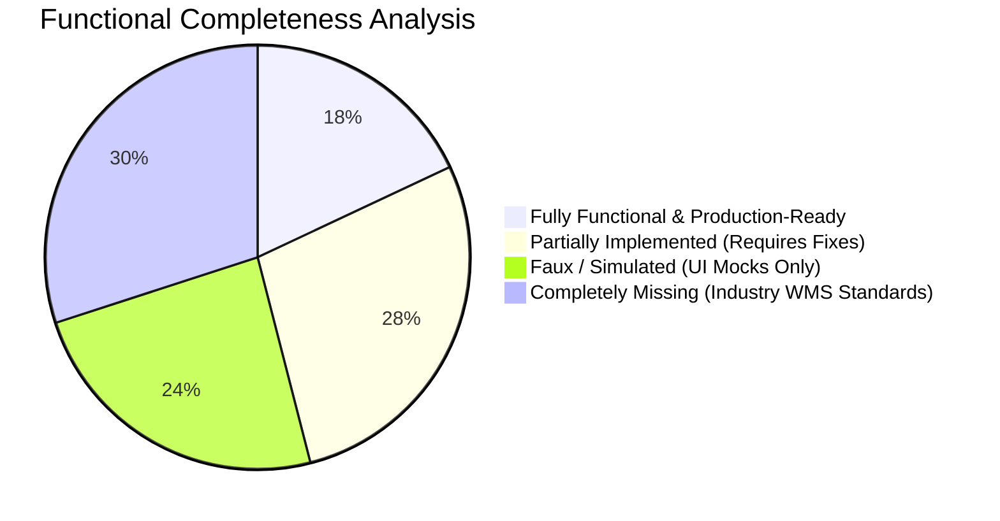
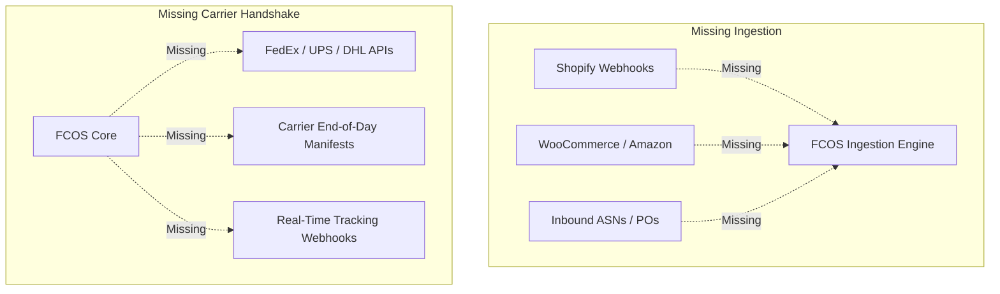
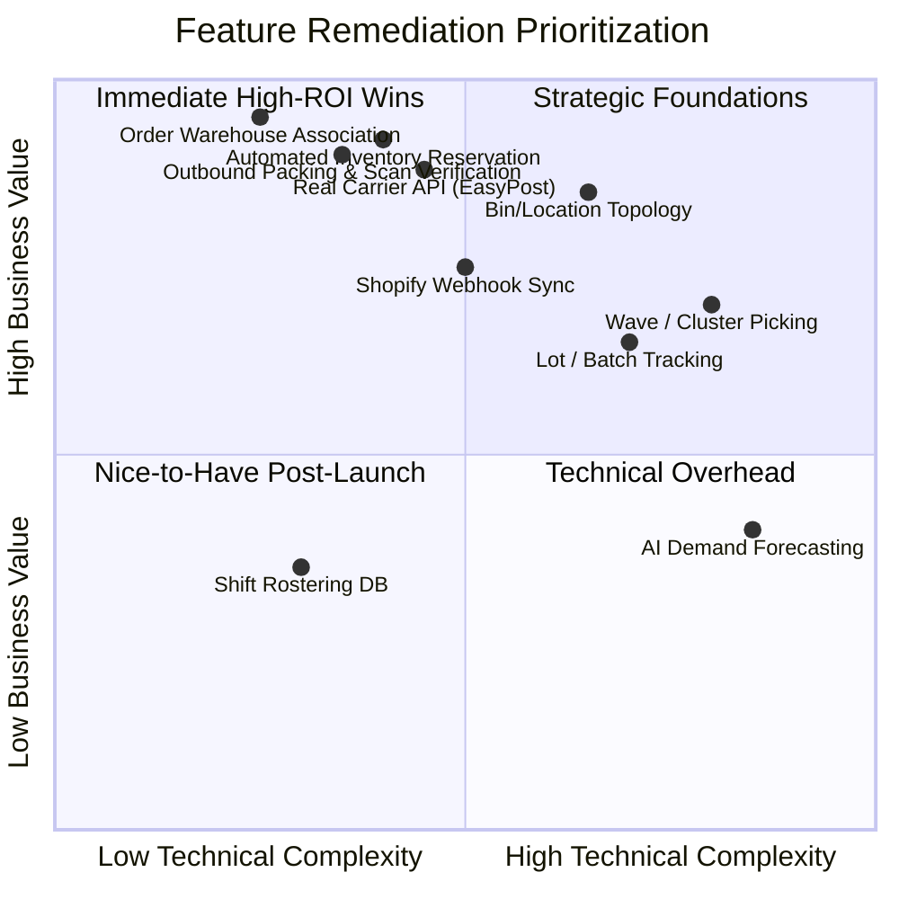

# FCOS Missing Features & Gap Analysis

**Document Reference:** `FCOS_AUDIT/10_MISSING_FEATURES.md`  
**Audit Date:** March 2025  
**Classification:** Strategic Product & Engineering Gap Analysis  
**Author:** Senior Software Architect & Full-Stack QA Lead  

---

## 1. Executive Summary: Documented vs Realized Capabilities

A modern Fulfillment Center Operating System (FCOS / WMS) must bridge digital e-commerce channels with physical warehouse material handling. While the FCOS codebase possesses a clean, visually appealing UI and core CRUD operations for catalogs and basic orders, **there is a profound gap between the documented enterprise vision and actual software execution.**

This document systematically details:
1. **Faux / Simulated Features** (Features with UI pages that do not actually work).
2. **Missing Core Warehouse Execution Modules** (Standard physical fulfillment operations absent from code).
3. **Missing E-Commerce & Carrier Integrations** (Supply chain connectivity gaps).
4. **Missing Multi-Tenancy & Governance Infrastructure**.

---

## 2. Faux & Simulated Features (UI Exists, No Real Functionality)

The following modules display polished dashboards and forms in the frontend, but their operations are purely simulated using in-memory React state, static JSON fixtures, or pseudo-random number generators:

| Feature Name | Frontend Path | Actual Implementation Reality | Missing Backend / DB Elements |
|---|---|---|---|
| **Courier Carrier APIs** | `/shipping` | Carrier tracking codes and shipping labels are generated via client-side string randomization (`"TRK-" + Math.random()`). | No API adapters for FedEx, UPS, DHL, ShipEngine, or EasyPost. No real label PDFs or carrier manifest generation. |
| **E-Commerce Sync** | `/integrations` | Shopify, WooCommerce, and Amazon buttons toggle local component state (`connected: true`). | No OAuth flow, no webhook receivers (`/webhooks/shopify`), no inventory sync queue, no catalog mapping. |
| **Billing & Invoicing** | `/billing` | Displays hardcoded table rows of invoices. "Download PDF" button triggers a dummy browser alert or downloads static sample text. | No billing engine, no 3PL storage fee calculations, no handling charge ledger, no Stripe/PayPal integration. |
| **Shift Rostering** | `/shifts` | Allows dragging staff into morning/evening shifts. Changes vanish permanently on page refresh. | No `Shift` or `Roster` models in Prisma schema; no `/shifts` REST controllers. |
| **AI Stock Insights** | `/ai-insights` | Displays charts forecasting 30-day stockouts. Backed by hardcoded array of 5 static SKU predictions. | No statistical engine (ARIMA, Holt-Winters), no Python microservice, no database query analyzing sales velocity. |
| **Support Helpdesk** | `/support` | Ticket creation modal appends to local React state array. | No `Ticket` model, no message threading, no email notifications, no staff assignment. |

---

## 3. Critical Missing Core Warehouse Operations

A commercial fulfillment center requires specialized physical handling logic that does not exist anywhere in the FCOS codebase:

### 3.1 Bin, Aisle, and Location Management (WMS Topology)
* **Current State:** The database has a single `warehouseId` on inventory. It assumes a warehouse is an open single room.
* **Missing Functionality:**
  - **Hierarchical Locations:** Aisle $\to$ Rack $\to$ Shelf $\to$ Bin (e.g., `A-04-B-02`).
  - **Pick Sequence Optimization:** Routing pickers through aisles along the shortest physical walking path (Traveling Salesperson Problem / S-shape routing).
  - **Putaway Rules:** Automated suggestion of storage bins based on SKU dimensions, velocity (fast-moving vs slow-moving ABC analysis), and weight limits.
  - **Bin Capacity Tracking:** Volume and weight limits per bin to prevent physical overload.

### 3.2 Advanced Picking Strategies
* **Current State:** Discrete order picking only (one picker walks the entire warehouse for one single order).
* **Missing Functionality:**
  - **Wave Picking:** Grouping orders by shipping cutoff time, carrier, or destination zone into waves.
  - **Batch / Cluster Picking:** A picker picks items for 6–12 orders simultaneously into a multi-tote cart, scanning items into specific order totes.
  - **Zone Picking:** Splitting orders across warehouse zones (e.g., dry goods vs refrigerated) and consolidating at a packing station.

### 3.3 Outbound Quality Control (QC) & Packing Stations
* **Current State:** `/qc` is exclusively customer return inspection. Outbound orders jump straight from `PICKED` to `SHIPPED`.
* **Missing Functionality:**
  - **Packing Station Barcode Verification:** Scan-to-verify every item into the shipping carton.
  - **Scale Integration & Weight Checks:** Comparing measured carton weight against expected bill-of-materials weight to catch missing items or packing mistakes automatically.
  - **Cartonization Algorithm:** Recommending optimal box sizes (Box Small, Box Medium, Box Large) based on item dimensions to minimize shipping volumetric charges.
  - **Packing Slip & Collateral Generation:** Automatic printing of branded packing slips and return labels inside the box.

### 3.4 Batch, Lot, and Expiry Date Tracking
* **Current State:** SKU quantity is a single flat integer (`quantity: 100`).
* **Missing Functionality:**
  - **Lot / Batch Numbers:** Inability to track manufacturing batches.
  - **Expiry Dates:** No FEFO (First-Expired, First-Out) picking logic. Perishable goods or cosmetics cannot be safely managed.
  - **Recall Management:** Inability to isolate and quarantine specific contaminated or defective batches across warehouses.

### 3.5 Serial Number Tracking
* **Current State:** No serial number tracking.
* **Missing Functionality:**
  - High-value electronics (smartphones, laptops) require scanning unique serialized identifiers (IMEI, MAC, Serial) at receiving and packing to prevent warranty fraud and return theft.

### 3.6 Cycle Counting & Inventory Adjustments
* **Current State:** Stock adjustments are manual direct edits to `quantity` in the database.
* **Missing Functionality:**
  - **Blind Cycle Counting:** Warehouse managers assign counting tasks without revealing the expected quantity to prevent staff fabrication.
  - **Discrepancy Approvals:** Variances exceeding $\$50$ require supervisor authorization before mutating ledger balances.
  - **ABC Cycle Count Schedules:** Fast-moving Class A SKUs counted monthly, Class B quarterly, Class C annually.

---

## 4. Missing Logistics & Supply Chain Integrations

### 4.1 Inbound Purchase Orders & Advance Shipping Notices (ASNs)
* **Gap:** Stock enters the warehouse today only through arbitrary manual increments (`/inventory/scan-in`). There is no concept of a Purchase Order (PO) from a supplier or an Advance Shipping Notice (ASN).
* **Impact:** Receiving staff cannot perform receiving cross-checks against supplier invoices, cannot track damaged in-transit freight, and cannot enforce supplier compliance.

### 4.2 Carrier Manifesting & Electronic Data Interchange (EDI)
* **Gap:** Carriers require an End-of-Day Electronic Manifest (e.g. USPS SCAN form, FedEx Ground manifest) summarizing all packages handed over to the truck driver. FCOS has no manifest generation or carrier pickup sign-off workflow.

### 4.3 Webhook Event Bus for E-Commerce Platforms
* **Gap:** No external-facing webhook architecture. When an order status changes to `SHIPPED` with tracking `TRK-123456`, FCOS does not notify Shopify, WooCommerce, or Magento, leaving online buyers without shipment notifications.

---

## 5. Missing Multi-Tenancy & Enterprise Governance

| Governance Layer | Current State in FCOS | Required Enterprise Specification |
|---|---|---|
| **Data Isolation** | Advisory filters in some endpoints; easily bypassed via BOLA. | Row-Level Security (Postgres RLS) or strict, enforced Prisma middleware auto-injecting `vendorId` across all reads/writes. |
| **Audit Logging** | Discontinuous writes in `AuditLog` table; missing before/after state diffs. | Immutable, append-only audit trail logging `userId`, `ipAddress`, `action`, `previousState`, `newState`, and timestamp for all financial/inventory mutations. |
| **3PL Storage & Handling Billing** | Hardcoded UI mockup. | Automated daily cubic-foot storage fee billing, per-pick and per-pack charges, pallet receiving fees, and automated billing exports. |
| **SSO & Directory Sync** | Basic email/password JWT only. | SAML 2.0 / OIDC integrations (Okta, Azure AD, Google Workspace) with SCIM user provisioning for warehouse workers. |
| **Fine-Grained RBAC** | 4 static roles (`SUPER_ADMIN`, `VENDOR_ADMIN`, `WAREHOUSE_MANAGER`, `STAFF`). | Dynamic permission matrix with granular claims (e.g. `inventory:read`, `inventory:adjust_threshold_100`, `orders:cancel`). |

---

## 6. Implementation Prioritization Matrix

To transform FCOS into a production-viable commercial platform, development must proceed along the strict priorities outlined in **`FCOS_AUDIT/12_REMEDIATION_ROADMAP.md`**.

