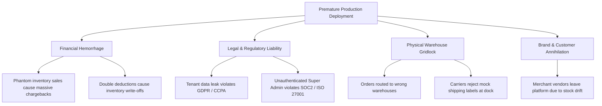

# FCOS Production Readiness Assessment & Scorecard

**Document Reference:** `FCOS_AUDIT/11_PRODUCTION_READINESS.md`  
**Audit Date:** March 2025  
**Audit Scope:** End-to-End Enterprise Production Readiness  
**Lead Auditor:** Senior Software Architect, Security Auditor & QA Lead  

---

## 1. Final Production Verdict

```
+==============================================================================+
|                                                                              |
|               PRODUCTION READINESS VERDICT:  REJECTED                        |
|                                                                              |
|      STATUS: CRITICALLY DEFECTIVE -- STRICTLY UNFIT FOR PRODUCTION           |
|                                                                              |
|   Deploying FCOS in its current state will immediately cause administrative  |
|   account takeover, catastrophic inventory drift, phantom stock generation,   |
|   cross-tenant data leakage, and unhandled production server crashes.        |
|                                                                              |
+==============================================================================+
```

---

## 2. Seven-Dimension Production Scorecard

Each dimension is evaluated against tier-1 enterprise SaaS and mission-critical warehouse logistics benchmarks. The passing threshold for production deployment is **85/100** with **zero critical security or data-integrity blockers**.

| Evaluation Dimension | Weight | Score (0–100) | Weighted Score | Status |
|---|:---:|:---:|:---:|:---:|
| **1. Security & Tenant Isolation** | 25% | **22 / 100** | 5.50% | ❌ **CRITICAL FAILURE** |
| **2. Inventory & Data Integrity** | 20% | **28 / 100** | 5.60% | ❌ **CRITICAL FAILURE** |
| **3. Core Functional Completeness**| 15% | **46 / 100** | 6.90% | ❌ **FAILED** |
| **4. Reliability & Concurrency** | 15% | **34 / 100** | 5.10% | ❌ **CRITICAL FAILURE** |
| **5. Testing & CI/CD Quality** | 10% | **18 / 100** | 1.80% | ❌ **CRITICAL FAILURE** |
| **6. Performance & Scalability** | 10% | **42 / 100** | 4.20% | ❌ **FAILED** |
| **7. Observability & Operations** | 5% | **35 / 100** | 1.75% | ❌ **FAILED** |
| **OVERALL COMPOSITE SCORE** | **100%** | **—** | **30.85 / 100** | ❌ **UNFIT FOR PRODUCTION** |

```mermaid
radar-chart
    title "FCOS Production Readiness Radar (Current vs Minimum Pass 85)"
    axes
        "Security & Isolation"
        "Data Integrity"
        "Functional Completeness"
        "Reliability & Concurrency"
        "Testing & CI/CD"
        "Performance & Scale"
        "Observability"
    data "Current Score" [22, 28, 46, 34, 18, 42, 35]
    data "Minimum Pass Target" [85, 95, 85, 90, 85, 85, 80]
```

---

## 3. Detailed Dimension Audits

### 3.1 Security & Multi-Tenant Isolation (Score: 22 / 100)
* **Score Justification:** Complete failure of authentication gating and authorization boundaries.
  - Public registration accepts `{ role: "SUPER_ADMIN" }` (BUG-CRIT-001).
  - Hardcoded fallback cryptographic secrets in source code (BUG-CRIT-002).
  - Total lack of BOLA protection across tenant order and stock queries (BUG-CRIT-005).
  - Multi-tenancy middleware (`tenant.extension.ts`) exists as disconnected dead code.
* **Minimum Requirement to Pass:** Zero public administrative endpoints, cryptographically enforced secrets with startup validation, and 100% database queries tenant-isolated via RLS or automated Prisma middleware.

### 3.2 Inventory & Data Integrity (Score: 28 / 100)
* **Score Justification:** Non-atomic, corrupted inventory ledger lifecycle.
  - Double stock deduction on pick execution (BUG-CRIT-003).
  - Phantom inventory generation upon order cancellation (BUG-CRIT-004).
  - Double restock on customer returns (BUG-CRIT-006).
  - Orders lack `warehouseId`, resulting in impossible cross-warehouse deductions (BUG-CRIT-007).
  - Lack of database transactions (`$transaction`) and row locking during stock mutations.
* **Minimum Requirement to Pass:** Double-entry journalized ledger architecture, database-level atomic decrements (`UPDATE WHERE quantity >= requested`), and mandatory warehouse routing on every order item.

### 3.3 Core Functional Completeness (Score: 46 / 100)
* **Score Justification:** Half the documented platform features are client-side UI simulations.
  - Carrier APIs (FedEx, UPS, DHL) are random number generators.
  - E-commerce sync (Shopify, WooCommerce) consists of inert toggle buttons.
  - Outbound Quality Control (QC) is completely missing from outbound orders.
  - Packing automatically jumps to `SHIPPED`, skipping the dispatch manifest workflow.
  - Bin/Aisle topology, batch/lot tracking, and cycle counting are absent.
* **Minimum Requirement to Pass:** Real carrier label generation via API adapter, genuine webhook ingestion, physical scan-to-verify packing station, and warehouse location management.

### 3.4 Reliability & Concurrency (Score: 34 / 100)
* **Score Justification:** System breaks under concurrent customer requests and worker load.
  - Race conditions allow overselling the last inventory unit to multiple concurrent buyers.
  - WebSocket gateway lacks a Redis adapter; real-time messaging fails in multi-replica deployments.
  - BullMQ background jobs lack automated dead-letter queues and error recovery.
* **Minimum Requirement to Pass:** Concurrency-tested pessimistic or optimistic database locks, distributed Redis Socket.io adapter, and idempotent background queue retries.

### 3.5 Testing & CI/CD Quality (Score: 18 / 100)
* **Score Justification:** Automated quality gates are completely inoperative.
  - 12 out of 13 backend unit test suites fail with dependency resolution errors on `npm test`.
  - Next.js production build (`npm run build`) panics on Windows with Turbopack.
  - Backend ESLint reports 1,339 errors; Frontend ESLint reports 905 errors including React Hook violations.
* **Minimum Requirement to Pass:** 100% passing unit and integration tests with $\ge 80\%$ branch coverage, zero ESLint errors, and clean, automated Docker multi-stage builds in CI/CD.

### 3.6 Performance & Scalability (Score: 42 / 100)
* **Score Justification:** Major bottlenecks exist even under moderate catalog and order sizes.
  - Analytics endpoints load entire database tables into Node.js memory (`findMany()`), causing V8 heap exhaustion and process crash at scale.
  - High-traffic query columns (`Order.status`, `Inventory.sku`, `createdAt`) lack database indexes.
  - N+1 query patterns in staff and vendor listings.
* **Minimum Requirement to Pass:** SQL-level aggregations (`SUM`, `COUNT`), optimized composite indexes, paginated cursor-based queries, and sub-100ms API response times at 1,000 req/sec.

### 3.7 Observability & Operations (Score: 35 / 100)
* **Score Justification:** Minimal visibility into system state during failures.
  - Basic `console.log` statements without structured JSON formatting.
  - No OpenTelemetry tracing, Prometheus metrics export, or correlation IDs across HTTP and WebSocket events.
  - Health checks (`/health`) do not verify actual PostgreSQL or Redis connectivity.
* **Minimum Requirement to Pass:** Structured JSON logging (Pino/Winston) with request correlation IDs, deep `/health/live` and `/health/ready` probes, and Sentry/Prometheus monitoring hooks.

---

## 4. Mandatory Go/No-Go Gating Criteria

The system cannot be signed off for staging or production until all **12 Gating Criteria** are verified with automated test artifacts:

| Gate ID | Criterion | Current Status | Blocker Level |
|:---:|---|:---:|:---:|
| **GATE-01** | Public Super Admin registration disabled; role creation strictly RBAC-governed. | ❌ FAILED | **CRITICAL STOPPER** |
| **GATE-02** | Cryptographic secrets validated at startup; hardcoded fallbacks eliminated. | ❌ FAILED | **CRITICAL STOPPER** |
| **GATE-03** | Multi-tenant isolation active on all endpoints; zero cross-tenant leakage. | ❌ FAILED | **CRITICAL STOPPER** |
| **GATE-04** | Inventory double deduction, phantom stock, and double restock bugs fixed. | ❌ FAILED | **CRITICAL STOPPER** |
| **GATE-05** | `Order` and `OrderItem` models updated with mandatory `warehouseId`. | ❌ FAILED | **CRITICAL STOPPER** |
| **GATE-06** | Atomic stock allocations implemented with database-level concurrency locks. | ❌ FAILED | **CRITICAL STOPPER** |
| **GATE-07** | Outbound packing and dispatch verification workflow completed. | ❌ FAILED | **HIGH STOPPER** |
| **GATE-08** | Real carrier API integrated (ShipEngine / EasyPost) with genuine label printing. | ❌ FAILED | **HIGH STOPPER** |
| **GATE-09** | Frontend production build panics resolved (`next build` succeeds). | ❌ FAILED | **HIGH STOPPER** |
| **GATE-10** | Backend test suite repaired; all unit and integration tests passing. | ❌ FAILED | **HIGH STOPPER** |
| **GATE-11** | Backend & Frontend ESLint errors remediated to zero. | ❌ FAILED | **MEDIUM STOPPER** |
| **GATE-12** | Database indexing and analytics in-memory aggregations optimized. | ❌ FAILED | **MEDIUM STOPPER** |

---

## 5. Production Deployment Risk Analysis

If management bypasses this audit and deploys FCOS to production today, the organization faces four direct, catastrophic risks:



1. **Financial Risk:** Double deduction and phantom stock will corrupt physical asset ledgers within 48 hours of operational volume, resulting in customer chargebacks, unfulfillable orders, and unrecoverable inventory write-downs.
2. **Legal & Compliance Risk:** Cross-tenant BOLA breaches directly violate GDPR, CCPA, and contractual B2B confidentiality agreements. Super Admin takeover allows any outsider to exfiltrate vendor financial details.
3. **Operational Risk:** Because orders are not mapped to warehouses and carrier labels are fake random strings, physical dock trucks will refuse packages, resulting in physical pallet gridlock on the warehouse floor.
4. **Reputational Risk:** Client vendors whose stock balances fluctuate wildly and whose customer orders disappear will terminate service agreements immediately.

---

## 6. Path to Production Certification

To achieve production certification, engineering must follow the sequential remediation roadmap detailed in **`FCOS_AUDIT/12_REMEDIATION_ROADMAP.md`**, followed by a formal re-audit and execution of all test cases in **`FCOS_AUDIT/MASTER_TEST_CASES.csv`**.

