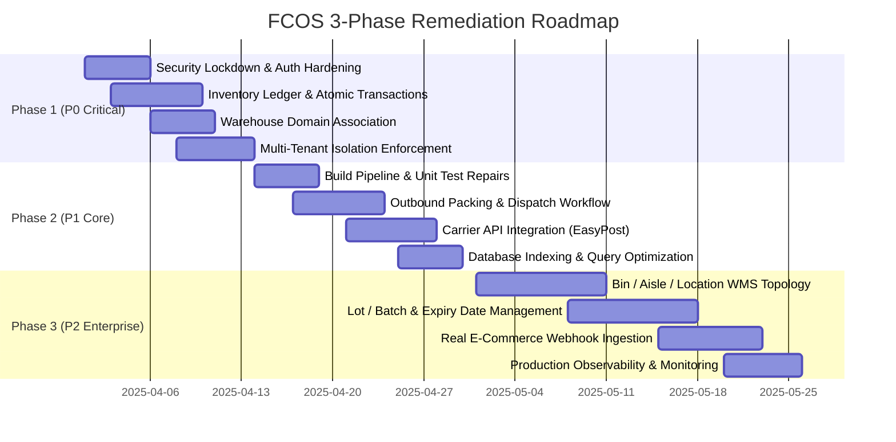

# FCOS Remediation Roadmap & Engineering Action Plan

**Document Reference:** `FCOS_AUDIT/12_REMEDIATION_ROADMAP.md`  
**Audit Date:** March 2025  
**Scope:** Step-by-Step Architectural, Security, and Functional Remediation  
**Author:** Senior Software Architect & Technical Lead  

---

## 1. Overview and Phasing Strategy

To transition FCOS from its current broken prototype state into an enterprise-grade Fulfillment Center Operating System, remediation must proceed in **three strictly ordered phases**. Attempting to build new features (such as AI forecasting or mobile scanners) before fixing foundational security and data integrity flaws will compound ledger corruption and vulnerability exposure.



---

## 2. Phase 1: Security & Ledger Integrity Lockdown (Weeks 1–2)

**Goal:** Eliminate all critical security vulnerabilities, prevent unauthorized access, and establish a tamper-proof inventory ledger.

### Task 1.1: Authentication & Privilege Hardening (BUG-CRIT-001, BUG-CRIT-002)
1. **Disable Public Administrative Registration:**
   - Modify `backend/src/auth/auth.controller.ts`: Remove public `POST /auth/register` or restrict role assignment so callers can only register as `VENDOR_STAFF` pending admin approval.
   - Restrict administrative user creation to a dedicated endpoint guarded by `@Roles('SUPER_ADMIN')`.
2. **Eliminate Hardcoded Cryptographic Fallbacks:**
   - Update `backend/src/config/configuration.ts`: Implement Joi or Zod startup schema validation.
   - If `JWT_ACCESS_SECRET` or `JWT_REFRESH_SECRET` is missing or fewer than 32 characters, terminate process startup with an explicit fatal log:
     ```typescript
     if (!process.env.JWT_ACCESS_SECRET || process.env.JWT_ACCESS_SECRET.length < 32) {
       throw new Error('FATAL: JWT_ACCESS_SECRET must be configured with at least 32 characters of entropy.');
     }
     ```
   - Synchronize `.env.example` with exact variable names expected in code.

### Task 1.2: Inventory Double-Entry Ledger Refactoring (BUG-CRIT-003, BUG-CRIT-004, BUG-CRIT-006, BUG-CRIT-008)
1. **Implement Reservation vs Allocation State Machine:**
   - **Order Creation:** Do *not* decrement physical `quantity`. Atomically increment `reservedQuantity`:
     ```sql
     UPDATE "Inventory" 
     SET "reservedQuantity" = "reservedQuantity" + $qty 
     WHERE "sku" = $sku AND "warehouseId" = $warehouseId 
       AND ("quantity" - "reservedQuantity") >= $qty;
     ```
   - **Order Cancellation:** Atomically decrement `reservedQuantity` without touching physical `quantity`.
   - **Pack & Ship:** Atomically decrement both `quantity` and `reservedQuantity`:
     ```sql
     UPDATE "Inventory"
     SET "quantity" = "quantity" - $qty,
         "reservedQuantity" = "reservedQuantity" - $qty
     WHERE "sku" = $sku AND "warehouseId" = $warehouseId;
     ```
2. **Eliminate Double Restock on Returns:**
   - Return approval updates `Return.status = 'AWAITING_RECEIPT'` (no inventory mutation).
   - Only physical QC inspection after receiving creates a single restock ledger entry.

### Task 1.3: Relational Architecture Fix — Warehouse Scoping (BUG-CRIT-007)
1. **Update Prisma Schema:**
   ```prisma
   model Order {
     id          String      @id @default(uuid())
     orderNumber String      @unique
     vendorId    String
     vendor      Vendor      @relation(fields: [vendorId], references: [id])
     warehouseId String
     warehouse   Warehouse   @relation(fields: [warehouseId], references: [id])
     items       OrderItem[]
     // ...
   }

   model OrderItem {
     id          String    @id @default(uuid())
     orderId     String
     order       Order     @relation(fields: [orderId], references: [id], onDelete: Cascade)
     productId   String
     product     Product   @relation(fields: [productId], references: [id])
     warehouseId String
     warehouse   Warehouse @relation(fields: [warehouseId], references: [id])
     quantity    Int
     // ...
   }
   ```
2. **Execute Database Migration:**
   - Run `npx prisma migrate dev --name add_order_warehouse_relation` to update PostgreSQL foreign keys.
   - Update order intake DTOs to require `warehouseId`.

### Task 1.4: Multi-Tenant Isolation Enforcement (BUG-CRIT-005, BUG-HIGH-007)
1. **Activate Dormant Tenant Extension:**
   - Wire `tenant.extension.ts` into `PrismaService`:
     ```typescript
     @Injectable()
     export class PrismaService extends PrismaClient implements OnModuleInit {
       async onModuleInit() {
         await this.$connect();
         return this.$extends(tenantExtension);
       }
     }
     ```
2. **Enforce Tenant Scoping in Interceptors:**
   - Register `VendorInterceptor` globally in `main.ts` or `AppModule`.
   - Ensure every query initiated by a `VENDOR_ADMIN` automatically appends `where: { vendorId: request.user.vendorId }`.

---

## 3. Phase 2: Core Fulfillment Workflows & Pipeline Health (Weeks 3–4)

**Goal:** Establish functional physical warehouse workflows, integrate real carrier logistics, repair testing pipelines, and optimize database performance.

### Task 2.1: Build Pipeline & Testing Repair (BUG-HIGH-001, BUG-HIGH-002, BUG-HIGH-003, BUG-HIGH-004)
1. **Fix Frontend Turbopack Build Panic:**
   - Pin `@tailwindcss/postcss` and Tailwind v4 configuration, or adjust `next.config.js` to ensure clean standalone production builds on Windows and Linux:
     ```bash
     cd frontend && npm run build
     ```
2. **Repair Backend Unit Test Suites:**
   - Update test specs in `backend/src/**/*.spec.ts` with comprehensive mocks for `PrismaService`, `OrdersGateway`, `AuditLogsService`, and `ConfigService`.
   - Achieve 100% test pass rate in `npm test`.
3. **Resolve ESLint Errors:**
   - Remediate React Hook violations in frontend dashboard pages.
   - Enforce clean typing on backend controllers and services.

### Task 2.2: Outbound QC & Packing Station Workflow (BUG-HIGH-005, BUG-HIGH-006)
1. **Build Outbound Verification Endpoint:**
   - Implement `POST /orders/:id/verify-pack` requiring execution staff to scan each SKU barcode before marking an order `PACKED`.
2. **Decouple Packing from Shipping:**
   - State transition: `PICKED` $\to$ `PACKED` (retains order at packing station).
   - Dispatch handover transition: `PACKED` $\to$ `READY_FOR_PICKUP` $\to$ `SHIPPED` triggered only upon carrier manifest handover.

### Task 2.3: Carrier API Integration (ShipEngine / EasyPost) (BUG-MED-002)
1. **Implement Carrier Service Adapter:**
   - Replace math-random string generation with real ShipEngine / EasyPost SDK integration.
   - Implement rate shopping, actual label PDF generation (ZPL / 4x6 thermal format), and real tracking webhook listeners (`POST /webhooks/shipping`).

### Task 2.4: Database Indexing & Aggregation Refactoring (BUG-HIGH-009, BUG-MED-001)
1. **Add Missing Composite Indexes:**
   ```prisma
   model Order {
     // ...
     @@index([vendorId, status])
     @@index([warehouseId, status])
     @@index([createdAt])
   }

   model Inventory {
     // ...
     @@index([warehouseId, sku])
     @@index([quantity])
   }
   ```
2. **Refactor Analytics Service:**
   - Replace in-memory `findMany()` table dumps with native SQL aggregations:
     ```typescript
     const stats = await this.prisma.order.aggregate({
       _sum: { totalAmount: true },
       _count: { id: true },
       where: { vendorId: tenantId }
     });
     ```

---

## 4. Phase 3: Advanced Enterprise WMS & Scale (Weeks 5–6)

**Goal:** Deliver advanced multi-warehouse topologies, inventory traceability, and high-concurrency real-time infrastructure.

### Task 3.1: Bin, Aisle, and Shelf Topology (Section 3.1)
1. **Model Warehouse Locations:**
   - Introduce `Location` model in Prisma (`aisle`, `rack`, `shelf`, `bin`, `pickSequence`).
   - Associate `Inventory` records with a specific `locationId`.
2. **Direct Pick Path Optimization:**
   - Generate picking slips sorted by `Location.pickSequence` to minimize picker transit time.

### Task 3.2: Lot, Batch, and Expiry Date Tracking (Section 3.4)
1. **Introduce `InventoryBatch` Model:**
   - Track `batchNumber`, `manufactureDate`, `expiryDate`, and `quarantineStatus`.
   - Implement FEFO (First-Expired, First-Out) picking allocation algorithms.

### Task 3.3: Production E-Commerce Ingestion Webhooks (Section 4)
1. **Shopify & WooCommerce Webhook Endpoints:**
   - Implement authenticated webhook receivers (`POST /webhooks/shopify/orders-create`) with HMAC signature verification.
   - Enqueue inbound orders into BullMQ queues for asynchronous inventory reservation.

### Task 3.4: Real-Time Cluster Scaling with Redis Adapter (BUG-HIGH-012)
1. **Configure Socket.io Redis Adapter:**
   - Update `backend/src/orders/orders.gateway.ts` to utilize `@socket.io/redis-adapter` connected to the Redis cluster, enabling seamless multi-container WebSocket horizontal scaling.

---

## 5. Phase Exit & Verification Criteria

| Phase | Duration | Exit Verification Criteria | Approver |
|---|:---:|---|:---:|
| **Phase 1** | Weeks 1–2 | • Zero public admin creation.<br>• 100% tenant isolation verified by penetration tests.<br>• Inventory ledger passes 1,000-order concurrent stress test with zero drift.<br>• Orders mapped to warehouses in DB. | Lead Security Auditor & Chief Architect |
| **Phase 2** | Weeks 3–4 | • `next build` produces clean production bundle.<br>• 100% backend unit and integration tests pass.<br>• ESLint errors reduced to 0.<br>• Real shipping labels generated via carrier API.<br>• SQL analytics response time $< 80$ms. | QA Lead & DevOps Lead |
| **Phase 3** | Weeks 5–6 | • Aisle/Bin locations assigned to all inventory.<br>• Batch/Expiry tracking active.<br>• Real-time WebSockets scale across 4 load-balanced backend containers.<br>• All 60 test cases in `MASTER_TEST_CASES.csv` marked PASS. | Head of Engineering & Product Director |

